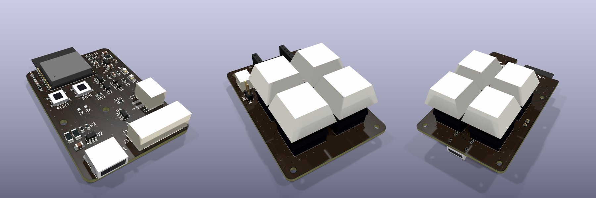

# Tune Button

A pocket remote for Spotify on Android. Press **♥** to like the song that's playing, or **+** to add
it to a playlist you choose. It runs for months on a small battery and charges over USB-C.

It is **not a Bluetooth keyboard**, so nothing on the phone gets remapped. Each press sends a small,
signed Bluetooth broadcast. A companion app hears it in the background, even with the phone locked,
and asks Spotify to like the song or add it.


<sub>The three four-key boards (renders; rev A is being made): `c3-jst` with buttons on a cable, the XIAO board, and the C3 board's key side.</sub>

```
 button ──wake──► ESP32-C3 ──signed BLE broadcast──► Android app ──HTTPS──► Spotify
                 (deep sleep)                      (listens in the         like / add
                                                    background)            to playlist
```

> **Status: works end to end.** A one-button unit on a XIAO ESP32-C3 liked the playing song from a
> locked Samsung phone; the app heard the press in 0.8 s. Still to do: a longer latency run on each
> scan mode, a battery-life measurement, and the custom circuit boards (rev A is ordered, not yet
> built). See [`docs/design.md`](docs/design.md).

## What you need

- **The button:** a Seeed Studio XIAO ESP32-C3, a small LiPo cell and one or two 12 mm tactile
  switches. [`hardware/wiring.md`](hardware/wiring.md) shows how to wire them. There's also a
  3D-printable case and three PCB options (see [Hardware](#hardware)).
- **An Android phone**, version 8.0 or later.
- **Spotify Premium.** Spotify requires it on the account that owns the developer app, and the
  developer app works for up to five users.

## Set up

### 1. Create a Spotify developer app

1. Sign in at [developer.spotify.com/dashboard](https://developer.spotify.com/dashboard) and create
   an app. Tick **Web API**.
2. Add the redirect URI **`tunebutton://callback`**.
3. Copy the **Client ID**. You don't need a client secret: the app signs in with PKCE.

### 2. Flash the firmware

With PlatformIO:

```bash
cd firmware
pio test -e native          # check the packet encoder and signature against the protocol vectors
pio run -t upload           # build and flash over USB-C
```

Or build one image you can flash from anywhere:

```bash
sh scripts/merge.sh         # → tune-button-c3.bin
```

Flash `tune-button-c3.bin` at offset `0x0`, either in Chrome with
[esptool-js](https://espressif.github.io/esptool-js/) or with
`esptool.py --chip esp32c3 write_flash 0 tune-button-c3.bin`.

**Only have one button?** Build `pio run -e xiao_esp32c3_1btn` (or `sh scripts/merge.sh xiao_esp32c3_1btn`)
and wire the button to D1. A press likes the song when you let go; holding it for 5 seconds pairs.

Things worth knowing:
- **The USB port vanishes while the button sleeps**, which is almost all the time. To flash it again,
  hold **BOOT** (the small button next to USB-C) while plugging it in. A button press also wakes it
  for 10 seconds, enough for an upload that's already waiting.
- **Flashing the merged image at `0x0` erases the pairing**, so pair again afterwards.
  `pio run -t upload` keeps it.
- Build options in `platformio.ini`: `TB_BURST_MS` (how long each press is broadcast) and `TB_LED_PIN`.

### 3. Install the app

```bash
cd android
./gradlew test assembleDebug      # needs JDK 17+ and Android SDK 35
```

Install `app/build/outputs/apk/debug/app-debug.apk` on the phone, open it and work down the screen:

1. Paste the Client ID and tap **Sign in to Spotify**.
2. Tap **Choose playlist** to pick where **+** adds songs.
3. **Pair:** hold both buttons for 3 seconds (one-button build: hold it for 5 seconds) until the LED
   flickers, then tap **Pair**. Accept the Bluetooth prompt if one appears. Pairing makes a fresh
   key, so a previously paired phone stops working; a pairing that no phone completes changes
   nothing.
4. Fix everything listed under *Keep listening in the background*. **On Samsung phones, also add the
   app to *Never sleeping apps*,** or presses stop being heard after a few days.
5. Tap **Test without the device** to check the Spotify side on its own.

## Using it

Press **♥** or **+**. Within a moment the phone buzzes once and shows a notification, for example
"♥ Liked — Title · Artist". If something goes wrong it buzzes twice and says why: nothing playing,
signed out, a local file, and so on. Podcast episodes work too.

The app's *Recent presses* list shows, for each press, how long the phone took to hear it, how long
Spotify took, the button's battery level and the result.

## Hardware

| Option | What it is | State |
|---|---|---|
| **Hand-wired XIAO** | A XIAO ESP32-C3 with one or two switches and a LiPo: [`hardware/wiring.md`](hardware/wiring.md) | One-button unit built and working |
| **3D-printed case** | Parametric OpenSCAD, with ready STLs: [`hardware/case/`](hardware/case/) | Ready to print |
| **Four-key PCBs** | Three boards: one carrying a XIAO, one with the ESP32-C3 module on board, and a small one that takes buttons on a cable. [`hardware/pcb/`](hardware/pcb/) | Rev A ordered |

The four-key boards need firmware support for the extra keys, which isn't written yet.

## How it's put together

| Path | What it is |
|---|---|
| [`firmware/`](firmware/) | PlatformIO / Arduino firmware for the ESP32-C3 (NimBLE) |
| [`android/`](android/) | The companion app (Kotlin, Android 8+) |
| [`protocol/`](protocol/) | The broadcast format, and `gen_vectors.py`, which makes the test vectors both sides check against |
| [`hardware/`](hardware/) | Wiring, parts, the case and the PCBs |
| [`docs/design.md`](docs/design.md) | How it works, security, power budget, latency and bench tests |

Each press is signed with a key shared at pairing and carries a counter, so the app ignores copies
and anything not from your button. [`docs/design.md`](docs/design.md) has the details.

## Licence

| What | Licence |
|---|---|
| The case and PCBs: `hardware/case/`, `hardware/pcb/` (OpenSCAD and KiCad sources, STLs) | [CERN-OHL-S-2.0](LICENSES/CERN-OHL-S-2.0.txt) |
| Firmware, app, protocol tools | [MIT](LICENSES/MIT.txt) |
| The Gradle wrapper (`android/gradlew*`, `android/gradle/wrapper/`), as shipped by Gradle | [Apache-2.0](LICENSES/Apache-2.0.txt) |
| Documentation (`README.md`, `docs/` including the renders, `hardware/wiring.md`, `protocol/spec.md`) | [CC BY 4.0](LICENSES/CC-BY-4.0.txt) |
| The EdgeCoil mark (`hardware/pcb/edgecoil-mark.svg` and the silkscreen drawn from it), name and URL | [All rights reserved](LICENSES/LicenseRef-EdgeCoil-Mark.txt) |

Each source file carries an SPDX header, and [`REUSE.toml`](REUSE.toml) covers the rest by path.

The board licence does not cover the EdgeCoil mark, name or URL on the silkscreen. If you make or
sell boards from these designs, take them off.

Spotify is a trademark of Spotify AB. This project is not affiliated with or endorsed by Spotify.

---

edgecoil · [edgecoil.dev](https://edgecoil.dev)
