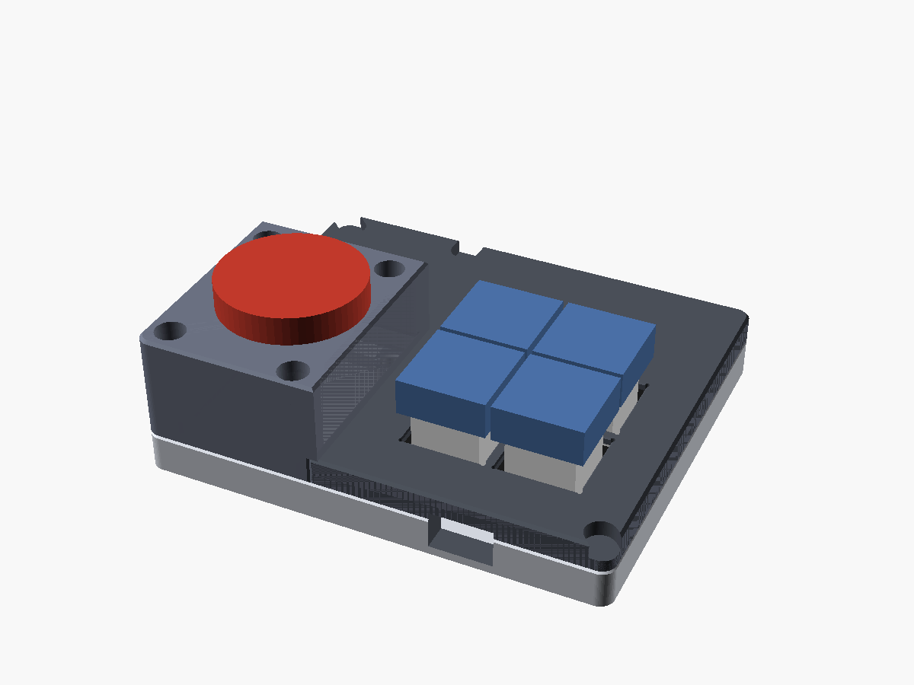

# Cases

Two kinds of case:

- **Printed:**
  - `tune-button.scad`: a hand-wired XIAO with two buttons.
  - `tune-button-1btn.scad`: a round puck for one 22 mm button.
  - `tune-button-printed.scad`: the `c3` and `xiao` four-key boards (see *Printed cases for `c3`
    and `xiao`* below).

  The instructions are at the top of each file.
- **Layered acrylic (`stack.scad`):** one for each four-key board, cut from 3 mm acrylic with very
  little printing. The rest of this page covers these.

> **Status: designed, not yet cut or built.** Every part on each board, read from the KiCad files,
> passes a clearance check against every layer (`check-stack.py`; see *Checking*). The heights of
> the keycaps, the arcade buttons and the JST plugs are estimates, and nothing has been
> test-fitted.

| | `xiao` | `c3` | `c3-jst` |
|---|---|---|---|
| Keys | 4 MX switches on the board | 4 MX switches on the board's back face | 4 × 22 mm arcade buttons on top, wired to J3 |
| Outside size | 65 × 80 × 33 mm (the visor) / 24 mm (the keys) | 65 × 83 × 24 mm | 80 × 80 × 51 mm |
| Layers | 11 | 8 | 17, or 6 plus one printed wall |
| Sheet (all layers) | 271 × 197 mm | 203 × 255 mm | 414 × 330 mm |
| Cell | 503040, under the board | 503040 (or 503035), under the board | 502030, beside the board |
| Bolts | 2 × M2 × 35, 2 × M2 × 26+ | 4 × M2 × 26+, **one of them nylon** | 4 × M3 × 54+ |
| Printed | 4 board spacers | 4 board spacers | nothing, or the wall (layers 5–15) |

## How they're built

Each case is a stack of 3 mm sheets, bolted through all four corners, numbered from `L00` (the
base) up. Every layer is drawn in the same top view, so cut them all the same way up and stack
them in order.

- **The cell sits in a pocket** in the layers under the board, and the battery plug has a pocket
  of its own beside the board edge. The cell stays clear of every part on the underside of the
  board.
- **USB-C goes through a slot in the wall,** sized for a plug overmould up to 13 × 8 mm.
- **On the MX boards, the switch plate is a layer** (`L06`). Its top sits 5.0 mm above the
  board's key face, as the Cherry MX spec requires. The board hangs from the plate by its soldered
  switches and rests on four printed spacers, whose pins locate it in its mounting holes. One more
  layer (`L07`) forms a 3 mm bezel around the keycaps.
  - **A 3 mm plate is thicker than the 1.5 mm the MX clips are made for.** The clips don't latch,
    and the solder joints hold the switches. The 14.0 mm holes should be a firm fit; cut the kerf
    test first.
- **`xiao`:** the XIAO stands about 13 mm above the board on its sockets, so a visor of three more
  layers covers it. The visor is open at the front, between the visor top and the keys. Stick the
  XIAO's FPC antenna to the underside of the visor top, `L10`.
- **`c3`:** the key face is up, so the module, USB-C and battery socket all face down into the
  case. The plate and bezel have windows for the two LEDs. With clear acrylic, the board's logo
  shows through the plate.
- **`c3-jst`:** the board and cell sit in pockets in the bottom five layers. The four arcade
  buttons hang from the top into an open 66 × 66 mm chamber above them. The 7-pin button plug
  and USB-C share the board's bottom edge, and the plug needs room in front of it. So the board
  sits 6 mm back from the wall, and the USB-C slot is about 12 mm deep. Most cables reach; a very
  short overmould may not.
  - The 11 ring layers (`L05`–`L15`) can be replaced by one printed part, `stack/c3-jst/wall.stl`,
    with the same footprint and bolt holes.

### The antenna corner

Metal near the ESP32-C3 module's antenna detunes it.
- **`c3`:** the top-right corner bolt (seen from above) is about 5 mm from the antenna. **Make
  that bolt nylon.**
- **`c3-jst`:** the nearest bolt, top left, is about 11 mm away. Metal is probably fine there;
  swap it for nylon if range is poor.

Moving these bolts along the wall instead was tried, and left only about 1.6 mm of acrylic beside
the cavity.

## Printed cases for `c3` and `xiao`

Printed alternatives to the `c3` and `xiao` stacks, from one file, `tune-button-printed.scad`:

| | `c3` | `xiao` |
|---|---|---|
| Parts | base, lid | base, lid, hood |
| Outside size | 64 × 82 × 21 mm | 64 × 79 × 33 mm |
| Screws | 3 × M3 × 8, plus a printed peg at the antenna corner | 4 × M3 × 8 |
| STLs | `tune-button-c3-base.stl`, `-lid.stl` | `tune-button-xiao-base.stl`, `-lid.stl`, `-hood.stl` |

- **The geometry comes from `stack.scad`:** the same cavity, cell pocket, battery-plug pocket,
  USB-C slot and board height. The same clearance check covers it.
- **The lid clamps the board.** Posts under the lid (and on `xiao`, brackets in the hood) press
  the board's key face down onto four spacers in the base, at its four mounting holes. The
  spacers' pins locate the board in the holes. Posts and spacers are sized to meet the board
  exactly, at the Cherry MX height, so they hold the board rather than the switch joints.
- **The lid's top face is a plate around the switches.** By default (`mx_fit = "over"`) its holes
  are 16.8 mm, so the lid goes down over switches **already soldered** to the board: they have to
  clear the switch's widest part, which measures 16.3 mm on these switches (the MX spec's top
  housing is 15.6), and 16.8 is the gauge hole they drop through easily. The posts clamp the board, so the plate doesn't need to hold the switches.
  **The first print used 14.1 mm holes** (the MX clip size) and stood 3 mm proud, riding on the
  switches' top housings. **So did the lids committed as "16.0 mm"**: `stack.scad` sets `mx_hole`
  first, and OpenSCAD evaluates a reassigned variable at its first assignment, so the override
  never took. The printed case now uses its own `pmx_hole`. If you'd rather clip the switches into
  the plate and solder them through it, the MX way, set `mx_fit = "clip"` (14.1 mm holes). Each
  hole has a 1 mm relief at its corners, since printed square holes come out with rounded
  corners. `tune-button-mx-gauge.stl` prints four test holes the same way as the lid (16.4–17.0
  mm, or 14.0–14.3 with `-D 'mx_fit="clip"'`): use the smallest one the switch passes. There is no bezel: the keycaps stand clear of a flat top. A bezel would have to print
  as a separate part or over a 38 mm bridge.
- **M3 × 8 socket head cap screws** go down through counterbores into M3 heat-set inserts in the
  base. Every head has 2.8 mm of plastic under it, and every screw reaches 5.2 mm into its insert.
  - The insert holes are 4.0 mm across and 7 mm deep, for the common M3 × 5.7 mm insert (4.6 mm
    outside diameter). Check your inserts' recommended hole and set `insert_hole` to match. A
    shorter M3 × 4 insert works too.
  - **`c3`:** the corner next to the module's antenna has no screw: a printed peg on the lid drops
    into a socket in the base instead. A brass insert there would be as bad as a steel screw.

### `xiao`: the hood and the antenna

The XIAO stands 13 mm above the board on its sockets, so a hood covers it, like the stack's visor.
It is open at the front, toward the keys, and the XIAO's USB-C comes out through its back wall.

- **The hood is the third part.** Its side walls sit on the lid's. Its back wall runs down to the
  base, and its two back corners go down through notches in the lid to the base's inserts. Those
  two screws hold the hood and the back of the lid.
- **Two brackets on the inside of the hood's back wall** clamp the board's two back holes. Their
  tops slope at 45° up to the wall, so they print without support.
- **The antenna goes in a 41 × 21 × 0.4 mm pocket under the hood's roof.** Peel the backing and
  stick it in, with its lead toward the XIAO's U.FL socket.
  - The pocket is sized for a 40 × 20 mm FPC antenna, the figure from a supplier's spec sheet.
    **Measure yours** and set `antenna` to match.
  - It is about 9 mm from the nearest corner screw and insert. The roof holds the antenna 1 mm
    above the XIAO, as the stack's visor does, and the XIAO is the nearest metal. If range is
    poor, raising `hood_top` gives the antenna more room above it.

### `c3` with a big button

`-D big_button=true` (with `variant="c3"`) adds a 22 mm panel-mount push button to the left of the
keys, seen from above with the USB-C at the bottom. It is printed only; there is no stack for it.

| | |
|---|---|
| Parts | base, lid, tower |
| Outside size | 96 × 82 mm; 14.6 mm tall over the keys and the cell, 31 mm at the tower |
| Screws | 7 × M3 × 8, plus the printed peg at the antenna corner |
| Cell | 502535 (25 × 35 × 5 mm), on the floor beside the tower, under the lid |
| STLs | `tune-button-c3-btn-base.stl`, `-lid.stl`, `-tower.stl` |

- **The board section is thin** because the cell no longer sits under the board. The board sits
  6.4 mm lower than on `c3`, with 1.2 mm under the battery socket J2, its tallest part below.
  **Don't fit the TP1 header**: it would hang 8.5 mm below the board. Solder wires to its pads.
- **The tower is the third part, and covers only the button's corner** (about 38 × 47 mm). Its
  roof takes the button: a 22.4 mm hole (22 mm, plus what FDM takes off a hole) in a 2.5 mm panel.
  The roof stands 31 mm above the bed: 26 mm of button below the panel's top face, 3 mm under its
  terminals for the wires, and the 2 mm floor. Its two inner walls are a riser that stands on the
  lid and clamps it. Four screws hold the tower, one near each of its corners: front-left,
  front-right at the step, one in its left wall just inside the back (clear of the cell's fence
  and about 5.6 mm clear of the nut), and one in the inner back corner, its boss filling the
  corner of the riser. In the base that last boss is joined to the cell's fence by a short web,
  since it stands only 0.1 mm off it.
- **The lid runs on over the cell,** flush with the top over the keys, so the case is 14.6 mm
  tall everywhere but the tower. The lid takes three screws: the far-left corner, mid-way along
  the far wall, and the near-right corner.
- **The button sits centred front to back on the tower's top,** with its body 4 mm clear of the
  battery plug's end, since the plug's lead leaves to the left, and its nut 4 mm from the front
  wall. The cell lies along the far wall
  inside a fence, behind the tower, and about 23 mm from the module's antenna.
- **The button's sizes:** measured, a 28.5 mm nut (`btn_nut_d`) and a 30 mm head, which sits on
  the roof with about 5 mm of roof around it. The 26 mm depth, terminals included, is also
  measured. One ESTIMATE: nothing below the nut is wider than 26 mm (`btn_body_d`). If the
  button's thread can't clamp a 2.5 mm panel, set `panel_t`. If it has an anti-rotation key, file
  a notch in the hole.
- **Wiring the button:** in parallel with one of the MX switches, soldered to that switch's two
  pins on the parts side, so it acts as that key and the firmware is unchanged. (The board has no
  spare key input; TP1's RXD pad, GPIO20, could be a fifth one with a firmware change.)
- **For printing:** the same chamfers as the other parts (bed edges, parting line, lead-ins,
  the screw seats' one-layer bridges, which are the only overhangs), and:
  - the button hole and the riser's top edge chamfered on the bed face;
  - 1 mm 45° fillets where the tower's roof meets its walls and riser, the most the nut
    leaves room for;
  - a 0.2 mm gap where the lid's cut-out meets the tower's walls, its top edges chamfered for
    elephant foot, and a V-groove down each of the two outside joints, as at the parting line.
- **The left-hand screws sit 5.0 mm in from the left edge,** not 3.6 mm. In the tower their
  counterbores are 20 mm shafts, and at 3.6 mm a shaft left about 0.5 mm at the corner, which the
  slicer drops on the roof's first layer. A slot out through the corner, as on the lid, would run
  the tower's full height.

### Printing

No supports for any part, 0.2 mm layers, 3 or more perimeters for the bosses.
- The base prints floor down.
- The lid STL is already upside down: its top face goes on the bed, and the skirt, bosses and
  posts grow up from it. Turn on elephant-foot compensation, or the first layer narrows the MX
  holes at the top face.
- The `xiao` hood STL is upside down too, roof on the bed, and so is the big-button tower.
- On `c3` the parting line runs through the USB-C opening, so each part has an open notch instead
  of a bridge. On `xiao` the USB-C window is in the hood's back wall, a 13 mm bridge.
- **Chamfers and fillets, for printing** (the sizes are parameters at the top of the file):
  - 0.6 mm on each part's bed edge, to take up elephant foot, and 0.4 mm on both edges at the
    parting line, so a small step between the parts reads as a groove.
  - 1 mm fillets where the 12 mm spacers meet the floor and the posts meet the plate.
  - Lead-ins on the insert holes, the peg and its socket, and the spacers' pins.
  - 0.3 mm on the MX holes at the top face.
- **Each screw hole is closed by one 0.2 mm layer at the bottom of its counterbore,** so the
  screw head's seat prints as a clean bridge instead of an overhang. Push the layer out with a
  3 mm drill or a hot awl before fitting the screws.
- **The lid's counterbores open out through its corners.** Only about 0.5 mm of wall stood between
  each head and the outer corner, less than the bed chamfer, so the slicer dropped it on the first
  layer and warned of floating regions, and a printed one chipped off. The head still bears on its
  whole seat. (The hood's screws sit in bosses and are unchanged.)

**Hardware:** M3 × 8 socket head cap screws (ISO 4762) and M3 heat-set inserts: 3 of each for
`c3`, 4 for `xiao`, 7 for the big-button `c3`.

**Assembly:**
1. **Set the inserts** into the base's corner bosses with a soldering iron, flush with the top
   of each boss.
2. **`c3`:** solder the LEDs. **`xiao`:** plug the XIAO into its sockets.
3. Solder the switches to the board.
4. Tape the cell inside its fence and plug in the battery, **checking the polarity first**.
5. Set the board on the base's spacers, their pins through its holes. Lower the lid over the
   switches (on `c3` its peg enters the socket) and screw down its corners; its posts clamp the
   board. (With `mx_fit = "clip"`, clip the switches into the lid and solder them through it
   instead, then lower lid and board together.)
6. **Big-button `c3`:** fit the button in the tower's roof and tighten its nut, solder its wires,
   and run them along the floor under the lid to the board. Lower the tower into the lid's
   corner cut-out, its riser onto the lid, and screw down its four screws.
7. **`xiao`:** stick the antenna in the hood's pocket and plug it into the XIAO. Lower the hood
   over the XIAO, its back corners through the lid's notches, and screw it down.

## Files

`./build-stack.sh` rebuilds everything in `stack/` from `stack.scad`, and the printed cases' STLs. It needs OpenSCAD 2021.01
or later, and `xvfb-run` for the preview images when headless.

| File | What |
|---|---|
| `stack/kerf-test.svg` | 64 × 30 mm test piece: an MX hole, both bolt sizes, a spacer hole, a 22.4 mm hole |
| `stack/<board>/Lnn-<kind>.svg` | one file per layer, `L00` at the bottom |
| `stack/<board>/sheet.svg`, `sheet.dxf` | every layer in one job |
| `stack/<board>/spacers.stl` | the four board spacers (`xiao`, `c3`) |
| `stack/c3-jst/wall.stl` | the printed alternative to layers 5–15 |
| `stack/<board>/preview.png` | assembly render |
| `tune-button-<board>-base.stl`, `-lid.stl`, `-hood.stl` | the printed `c3` and `xiao` cases (the lid and hood are upside down, ready to print); `stack/<board>/printed-preview.png` |
| `tune-button-c3-btn-base.stl`, `-lid.stl`, `-tower.stl` | `c3` with the big button (lid and tower upside down); `stack/c3-btn/printed-preview.png` |

The SVGs are in millimetres. `kerf` (default 0.10 mm) grows each outline and shrinks each hole
by half the kerf, so the cut parts come out at nominal size. Set it to your laser's kerf, and
`t` to your sheet's measured thickness. Heights are counted in whole sheets: if your "3 mm" sheet
is 2.8 mm, the MX plate's 5.0 mm sits wrong, so measure it.

## Before you cut

1. **Cut `kerf-test.svg`.** Adjust `kerf` until an MX switch is a firm push into the 14.0 mm hole
   and the bolts pass freely. Rebuild.
2. **Measure what the design has had to estimate:**
   - the arcade buttons' depth below the panel, wired (32 mm assumed) and their nut (30 mm
     across corners);
   - your keycaps: about 13 mm above the plate is assumed, as for an OEM R3 cap;
   - your USB-C cable's overmould (13 × 8 mm allowed);
   - your cells (the pockets add 1 mm to length and width; a cell plus foam tape gets 6 mm of
     depth).
3. Print the spacers upright, in PETG or PLA, at 0.2 mm layers.

## Assembly

### `xiao` and `c3`

1. **`c3`:** solder the two back LEDs first, since the plate covers them.
2. **Put the four MX switches through the plate (`L06`) from above, seat them in the board, and
   solder them.** The plate and board are now one assembly. On `xiao`, plug the XIAO into its
   sockets.
3. Lay `L00` (the base), `L01` and `L02`. **Fix the cell in its pocket with foam tape**, and stand
   the four spacers in their holes.
4. Add `L03`, `L04` and `L05`. **Check the battery lead's polarity against the + mark, and plug it
   in.** The plug sits in the side pocket.
5. Lower the board and plate assembly so that the spacers' pins enter the board's mounting holes.
6. Add `L07` (the bezel). On `xiao`, add `L08`–`L10`, with the antenna stuck under `L10`.
7. Bolt through the corners, heads on top, with nuts underneath. On `c3`, use the **nylon bolt in
   the top-right corner**. Cut each bolt to the stack height plus 2 mm. Fit the keycaps, and stick
   feet under the base, next to the nuts.

### `c3-jst`

1. **Fit the four buttons in the top (`L16`) and tighten their nuts.** Wire each one between its
   K pin on the J3 pigtail and GND (pin 1). A lit button's LED goes on pin 6; it must be a bare
   LED with no built-in resistor.
2. Lay `L00` and `L01`, and pass two M2 × 10 screws up through them at the board's holes. **The
   one at H2 (the right-hand hole, near the middle of the board) must be nylon.**
3. Add `L02`–`L04`. Drop the board onto the screws, and fit the nuts (nylon at H2). Fix the cell
   in its pocket and plug in the battery, **checking the polarity first**. Plug in J3.
4. Add `L05`–`L15` (or the printed wall), then the top. Bolt through with the M3 bolts.

## Getting at BOOT

You don't need BOOT for most uploads. A key press wakes the board for 10 seconds, which is enough
for an upload that's already waiting (see the main README). BOOT is only needed to recover a board
whose firmware doesn't boot. For that, unbolt the case.

## Checking

`python3 check-stack.py` checks every layer of the three stacks, and every part of the printed `c3`, `xiao`
and big-button `c3` cases.
It reads every footprint, and each board's outline and mounting holes, from the KiCad files in
`../pcb`. It gives each part
a height (listed in the script; connector and keycap heights are estimates), adds the cells,
plugs, keycaps and arcade buttons, and intersects each one, and the bare board, with every layer in
OpenSCAD. For the printed cases it also checks that no two parts overlap, and that a spacer and a post
or bracket meet the board at every mounting hole. It exits 1 on any failure.

Passing extra overrides runs it against a deliberately broken design, which shows it can fail.
For example, `python3 check-stack.py mx_hole=13.5` and `'usb_slot=[8,8]'` both report collisions.
