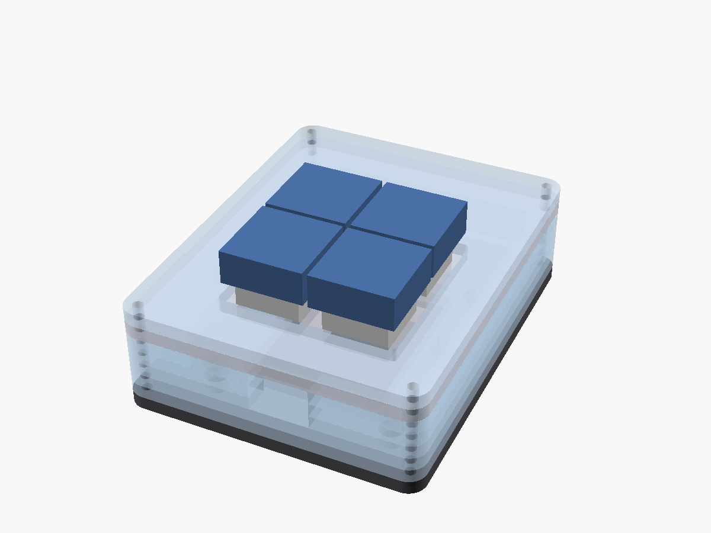

# Cases

Two kinds of case:

- **Printed:**
  - `tune-button.scad`: a hand-wired XIAO with two buttons.
  - `tune-button-1btn.scad`: a round puck for one 22 mm button.
  - `tune-button-c3-printed.scad`: the `c3` four-key board (see *Printed `c3` case* below).

  The instructions are at the top of each file.
- **Layered acrylic (`stack.scad`):** one for each four-key board, cut from 3 mm acrylic with very
  little printing. The rest of this page covers these.

> **Status: designed, not yet cut or built.** Every part on each board, read from the KiCad files,
> passes a clearance check against every layer (`check-stack.py`; see *Checking*). The heights of
> the keycaps, the arcade buttons and the JST plugs are estimates, and nothing has been
> test-fitted.

| | `xiao` | `c3` | `c3-jst` |
|---|---|---|---|
| Keys | 4 MX switches on the board | 4 MX switches on the board's back face | 4 × 22 mm arcade buttons on top, wired to J3 |
| Outside size | 65 × 80 × 33 mm (the visor) / 24 mm (the keys) | 65 × 83 × 24 mm | 80 × 80 × 51 mm |
| Layers | 11 | 8 | 17, or 6 plus one printed wall |
| Sheet (all layers) | 271 × 197 mm | 203 × 255 mm | 414 × 330 mm |
| Cell | 503040, under the board | 503040 (or 503035), under the board | 502030, beside the board |
| Bolts | 2 × M2 × 35, 2 × M2 × 26+ | 4 × M2 × 26+, **one of them nylon** | 4 × M3 × 54+ |
| Printed | 4 board spacers | 4 board spacers | nothing, or the wall (layers 5–15) |

## How they're built

Each case is a stack of 3 mm sheets, bolted through all four corners, numbered from `L00` (the
base) up. Every layer is drawn in the same top view, so cut them all the same way up and stack
them in order.

- **The cell sits in a pocket** in the layers under the board, and the battery plug has a pocket
  of its own beside the board edge. The cell stays clear of every part on the underside of the
  board.
- **USB-C goes through a slot in the wall,** sized for a plug overmould up to 13 × 8 mm.
- **On the MX boards, the switch plate is a layer** (`L06`). Its top sits 5.0 mm above the
  board's key face, as the Cherry MX spec requires. The board hangs from the plate by its soldered
  switches and rests on four printed spacers, whose pins locate it in its mounting holes. One more
  layer (`L07`) forms a 3 mm bezel around the keycaps.
  - **A 3 mm plate is thicker than the 1.5 mm the MX clips are made for.** The clips don't latch,
    and the solder joints hold the switches. The 14.0 mm holes should be a firm fit; cut the kerf
    test first.
- **`xiao`:** the XIAO stands about 13 mm above the board on its sockets, so a visor of three more
  layers covers it. The visor is open at the front, between the visor top and the keys. Stick the
  XIAO's FPC antenna to the underside of the visor top, `L10`.
- **`c3`:** the key face is up, so the module, USB-C and battery socket all face down into the
  case. The plate and bezel have windows for the two LEDs. With clear acrylic, the board's logo
  shows through the plate.
- **`c3-jst`:** the board and cell sit in pockets in the bottom five layers. The four arcade
  buttons hang from the top into an open 66 × 66 mm chamber above them. The 7-pin button plug
  and USB-C share the board's bottom edge, and the plug needs room in front of it. So the board
  sits 6 mm back from the wall, and the USB-C slot is about 12 mm deep. Most cables reach; a very
  short overmould may not.
  - The 11 ring layers (`L05`–`L15`) can be replaced by one printed part, `stack/c3-jst/wall.stl`,
    with the same footprint and bolt holes.

### The antenna corner

Metal near the ESP32-C3 module's antenna detunes it.
- **`c3`:** the top-right corner bolt (seen from above) is about 5 mm from the antenna. **Make
  that bolt nylon.**
- **`c3-jst`:** the nearest bolt, top left, is about 11 mm away. Metal is probably fine there;
  swap it for nylon if range is poor.

Moving these bolts along the wall instead was tried, and left only about 1.6 mm of acrylic beside
the cavity.

## Printed `c3` case

A printed alternative to the `c3` stack, in two parts: `tune-button-c3-base.stl` and
`tune-button-c3-lid.stl`. It's 64 × 82 × 21 mm.

- **Its geometry comes from `stack.scad`:** the same cavity, cell pocket, battery-plug pocket,
  USB-C slot and board height. The same clearance check covers it.
- **The lid clamps the board.** Four posts under the lid press the board's key face down onto four
  spacers in the base, at its four mounting holes. The spacers' pins locate the board in the holes.
  Posts and spacers are sized to meet the board exactly, at the Cherry MX height, so they hold the
  board rather than the switch joints.
- **The lid's top face is the MX plate**, 1.5 mm thick, so the switch clips latch. Its holes are
  14.1 mm because FDM prints holes slightly small. If your switches are loose, set `mx_hole` back
  to 14.0. There is no bezel: the keycaps stand clear of a flat top. A bezel would have to print
  as a separate part or over a 38 mm bridge.
- **Three M3 × 8 socket head cap screws** go down through counterbores in the lid's corners, into
  M3 heat-set inserts in the base. The heads sit just below the top face, with 2.8 mm of lid under
  them, and each screw reaches 5.2 mm into its insert.
  - The insert holes are 4.0 mm across and 7 mm deep, for the common M3 × 5.7 mm insert (4.6 mm
    outside diameter). Check your inserts' recommended hole and set `insert_hole` to match. A
    shorter M3 × 4 insert works too.
  - The fourth corner is next to the antenna, so it has no screw: a printed peg on the lid drops
    into a socket in the base instead. A brass insert there would be as bad as a steel screw.
- **Printing:** no supports for either part, 0.2 mm layers, 3 or more perimeters for the bosses.
  - The base prints floor down.
  - The lid STL is already upside down: its top face goes on the bed, and the skirt, bosses and
    posts grow up from it. Turn on elephant-foot compensation, or the first layer narrows the
    MX holes at the top face.
  - The parting line runs through the USB-C opening, so each part has an open notch instead of a
    bridge.

**Hardware:** 3 × M3 × 8 socket head cap screws (ISO 4762), 3 × M3 heat-set inserts.

**Assembly:**
1. **Set the three inserts** into the base's corner bosses with a soldering iron, flush with the
   top of the boss.
2. Solder the LEDs.
3. Put the switches through the lid from above, so their clips latch, and solder them to the
   board. The lid and board are now one assembly.
4. Tape the cell inside its fence and plug in the battery, **checking the polarity first**.
5. Lower the lid and board onto the base. The spacers' pins enter the board's holes, and the peg
   enters its socket. Screw the lid down.

## Files

`./build-stack.sh` rebuilds everything in `stack/` from `stack.scad`. It needs OpenSCAD 2021.01
or later, and `xvfb-run` for the preview images when headless.

| File | What |
|---|---|
| `stack/kerf-test.svg` | 64 × 30 mm test piece: an MX hole, both bolt sizes, a spacer hole, a 22.4 mm hole |
| `stack/<board>/Lnn-<kind>.svg` | one file per layer, `L00` at the bottom |
| `stack/<board>/sheet.svg`, `sheet.dxf` | every layer in one job |
| `stack/<board>/spacers.stl` | the four board spacers (`xiao`, `c3`) |
| `stack/c3-jst/wall.stl` | the printed alternative to layers 5–15 |
| `stack/<board>/preview.png` | assembly render |
| `tune-button-c3-base.stl`, `tune-button-c3-lid.stl` | the printed `c3` case (the lid is upside down, ready to print); `stack/c3/printed-preview.png` |

The SVGs are in millimetres. `kerf` (default 0.10 mm) grows each outline and shrinks each hole
by half the kerf, so the cut parts come out at nominal size. Set it to your laser's kerf, and
`t` to your sheet's measured thickness. Heights are counted in whole sheets: if your "3 mm" sheet
is 2.8 mm, the MX plate's 5.0 mm sits wrong, so measure it.

## Before you cut

1. **Cut `kerf-test.svg`.** Adjust `kerf` until an MX switch is a firm push into the 14.0 mm hole
   and the bolts pass freely. Rebuild.
2. **Measure what the design has had to estimate:**
   - the arcade buttons' depth below the panel, wired (32 mm assumed) and their nut (30 mm
     across corners);
   - your keycaps: about 13 mm above the plate is assumed, as for an OEM R3 cap;
   - your USB-C cable's overmould (13 × 8 mm allowed);
   - your cells (the pockets add 1 mm to length and width; a cell plus foam tape gets 6 mm of
     depth).
3. Print the spacers upright, in PETG or PLA, at 0.2 mm layers.

## Assembly

### `xiao` and `c3`

1. **`c3`:** solder the two back LEDs first, since the plate covers them.
2. **Put the four MX switches through the plate (`L06`) from above, seat them in the board, and
   solder them.** The plate and board are now one assembly. On `xiao`, plug the XIAO into its
   sockets.
3. Lay `L00` (the base), `L01` and `L02`. **Fix the cell in its pocket with foam tape**, and stand
   the four spacers in their holes.
4. Add `L03`, `L04` and `L05`. **Check the battery lead's polarity against the + mark, and plug it
   in.** The plug sits in the side pocket.
5. Lower the board and plate assembly so that the spacers' pins enter the board's mounting holes.
6. Add `L07` (the bezel). On `xiao`, add `L08`–`L10`, with the antenna stuck under `L10`.
7. Bolt through the corners, heads on top, with nuts underneath. On `c3`, use the **nylon bolt in
   the top-right corner**. Cut each bolt to the stack height plus 2 mm. Fit the keycaps, and stick
   feet under the base, next to the nuts.

### `c3-jst`

1. **Fit the four buttons in the top (`L16`) and tighten their nuts.** Wire each one between its
   K pin on the J3 pigtail and GND (pin 1). A lit button's LED goes on pin 6; it must be a bare
   LED with no built-in resistor.
2. Lay `L00` and `L01`, and pass two M2 × 10 screws up through them at the board's holes. **The
   one at H2 (the right-hand hole, near the middle of the board) must be nylon.**
3. Add `L02`–`L04`. Drop the board onto the screws, and fit the nuts (nylon at H2). Fix the cell
   in its pocket and plug in the battery, **checking the polarity first**. Plug in J3.
4. Add `L05`–`L15` (or the printed wall), then the top. Bolt through with the M3 bolts.

## Getting at BOOT

You don't need BOOT for most uploads. A key press wakes the board for 10 seconds, which is enough
for an upload that's already waiting (see the main README). BOOT is only needed to recover a board
whose firmware doesn't boot. For that, unbolt the case.

## Checking

`python3 check-stack.py` checks every layer of the three stacks, and the printed `c3` base and lid.
It reads every footprint, and each board's outline and mounting holes, from the KiCad files in
`../pcb`. It gives each part
a height (listed in the script; connector and keycap heights are estimates), adds the cells,
plugs, keycaps and arcade buttons, and intersects each one, and the bare board, with every layer in
OpenSCAD. For the printed `c3` case it also checks that the base and lid don't overlap, and that a
spacer and a post meet the board at every mounting hole. It exits 1 on any failure.

Passing extra overrides runs it against a deliberately broken design, which shows it can fail.
For example, `python3 check-stack.py mx_hole=13.5` and `'usb_slot=[8,8]'` both report collisions.
