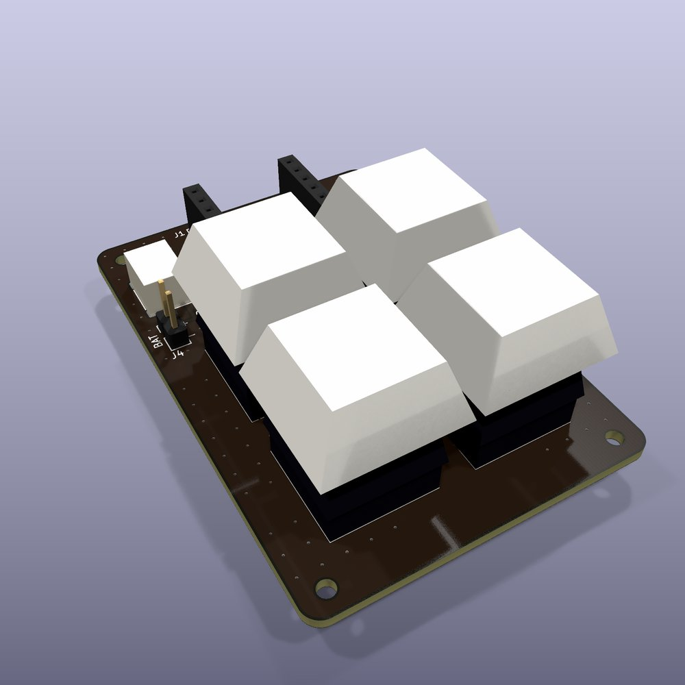
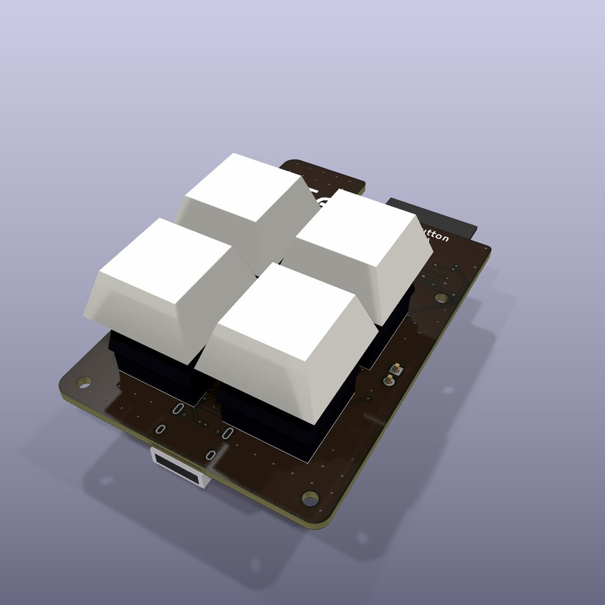
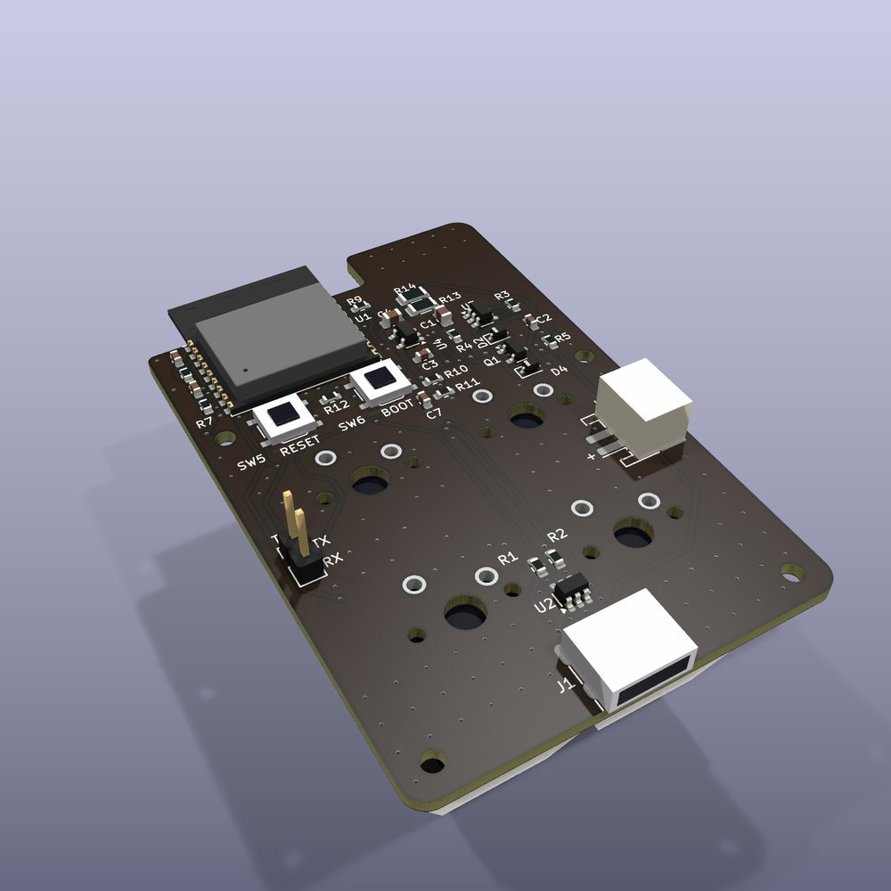
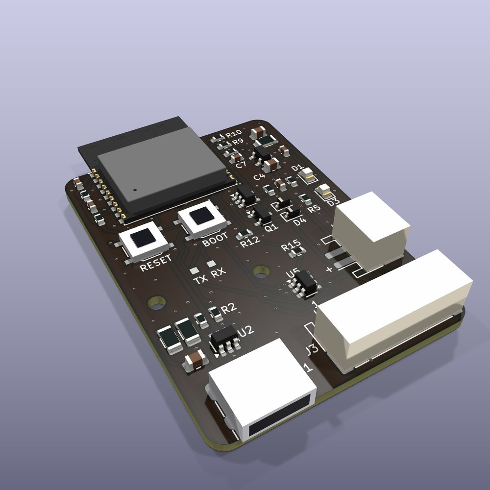

# Four-key PCBs

Three circuit boards for a four-key Tune Button:

- **`xiao/`**: a Seeed XIAO ESP32-C3 plugged into sockets, with four Cherry MX switches.
- **`c3/`**: the ESP32-C3 module, USB-C, charger and regulator on the board itself, with four MX
  switches on the back.
- **`c3-jst/`**: the same circuit as `c3/` on a much smaller board, with the buttons on wires to a
  7-pin JST connector instead of switches on the board.

The MX boards put their switches in a 2 × 2 grid at the standard 19.05 mm keyboard pitch.

| `xiao/` | `c3/` (key side) | `c3/` (parts side) | `c3-jst/` |
|---|---|---|---|
|  |  |  |  |

<sub>Rendered from the design files with KiCad. The connectors, switches and keycaps are simplified
stand-ins.</sub>

> **Status: rev A was ordered on 2026-10-25 (tag `rev-a`, all three boards on one JLC panel) and is
> not yet built or tested.** Every board passes KiCad's electrical and design rules checks, with
> nothing unconnected and the board matching its schematic. The four-key firmware is written but
> hasn't run on these boards yet (see [Firmware](#firmware)).

## The three boards at a glance

| | `xiao/` | `c3/` | `c3-jst/` |
|---|---|---|---|
| Size | 46 × 67 mm | 46 × 69.7 mm | 36 × 50 mm |
| Brain | XIAO ESP32-C3 on two 1 × 7 sockets | ESP32-C3-WROOM-02 module; its antenna sits over a notch in the top-left corner | The same module; its antenna overhangs the top edge |
| Keys | 4 MX on the board | 4 MX on the back | A 7-pin JST-PH (J3) for your own buttons |
| USB-C, charger, 3.3 V | On the XIAO | On the board: TP4054 charger (≈ 200 mA), load sharing, RT9080 regulator (600 mA, about 2 µA when idle) | As `c3/` |
| USB-C position | On the XIAO, top edge | Centre of the bottom edge | Bottom edge, left |
| Battery | JST-PH socket, wired to the XIAO's BAT pads | JST-PH socket | JST-PH socket (J2), right edge |
| Which side is which | Everything on top | Keys, LEDs, logo and name on the back (the key side); all the electronics on the front, facing into the case | Every part on the front; logo, name and the J3 pin list on the back |
| Mounting | 4 × M2 | 4 × M2 | 2 × M2 (see [Mounting](#mounting)) |
| Soldered by you | The MX switches | The MX switches and 2 LEDs on the back | Nothing (JLC fits every part) |

### `c3-jst`'s button connector (J3)

JST-PH, 2 mm pitch. Each button goes between its K pin and GND.

| Pin | 1 | 2 | 3 | 4 | 5 | 6 | 7 |
|---|---|---|---|---|---|---|---|
| Signal | GND | K1 | K2 | K3 | K4 | LED | 3V3 |

- **LED (pin 6)** goes through a 330 Ω resistor: about 4 mA into a red LED, enough for a lit button.
  It is the one pin without an ESD clamp, guarded only by R15 and the chip's own protection.
- **3V3 (pin 7)** is the regulator's output, shared with the module's 350 mA Wi-Fi bursts. Keep
  what you hang on it under about 100 mA.
- The key lines have their own ESD array (U5), since they run out on wires to buttons people touch.

## When the boards arrive

- **On `c3-jst`, check R16 and C8 are fitted** (top right, beside the regulator). They damp the
  ringing when USB is plugged in: without them a long cable can push the regulator's input to
  about 6.6 V, past its 6.5 V limit.
- **Cut `c3-jst`'s two right-edge panel tabs with flush cutters; don't snap them.** They sit close
  to the connectors' anchor pads. File the remnants flush.
- **Check the battery plug before connecting a cell.** Pin 1 (marked **+**) is the positive side,
  but JST-PH LiPo leads aren't wired consistently between sellers, and nothing on the boards
  protects against a reversed cell.
- **With USB in and no cell,** 3V3 should read 3.3 V before anything else is connected.

## Ordering

The boards are ordered as **one panel** with JLC's Standard assembly: the ESP32 module needs
Standard, and Standard needs at least 70 × 70 mm, which no single board is. Run `./build.sh`, then
`python3 panel.py` (see [Rebuilding](#rebuilding)), and upload from `panel/fab/`.

**PCB options**
- Upload `tune-button-panel-gerbers.zip`. It should read about 148 × 87 mm, 2 layers.
- Different designs **3**, delivery format **Panel by customer**.
- 1.6 mm, **black** mask, white legend, **lead-free HASL**.
- Min via hole **0.3mm/(0.4/0.45mm)**, the standard option. No hole is under 0.3 mm, and the
  0.2 mm option took the quote from $20 to $70.
- Mark on PCB: **Remove Mark**. The boards carry no order-number marker.

**Assembly**
- **Standard**, **top side only**. Upload `tune-button-panel-jlc-bom.csv` and
  `tune-button-panel-jlc-cpl.csv`.
- Add a remark: *"Customer panel of 3 designs. The modules' antennas and the USB-C sockets overhang
  their board edges by design."*
- Each part is prefixed with its board (`XIAO_`, `C3_`, `JST_`).
- **Check the placement preview before paying.** `edgecoil_pcb.jlc` (in `vendor/`) already corrects every
  rotation where JLC's footprint differs from KiCad's, each checked pad by pad against JLC's own footprint by
  `edgecoil_pcb.jlc_verify` (RT9080, AO3401A, SRV05-4, TP4054, USB-C, the 7-pin JST, the
  XIAO board's sockets and header), but a wrong SRV05-4 rotation (U2, and U5 on `c3-jst`) would
  short the 3V3 rail.

**What JLC fits and what's left for you**
- JLC fits everything on the front of each board, including the XIAO board's sockets and 2-pin
  header. Those are through-hole, at a hand-soldering fee of about $3.50 plus a per-joint rate.
- Left for you: the MX switches, the C3 board's two back LEDs and its UART header, the XIAO itself,
  the batteries and the buttons.

**Part costs.** Parts are chosen to keep JLC's per-type fee down:
- **Basic or Preferred, no fee:** every passive, the LEDs, the MOSFET, the diodes, the tact
  switches, the TP4054 charger and the SRV05-4 ESD part.
- **Extended, one fee per type:** seven types, namely the ESP32-C3 module, the USB-C socket, the
  battery JST, the RT9080 regulator, `c3-jst`'s 7-pin JST, and the XIAO board's sockets (C2932672,
  8.5 mm tall) and header (C492401).

Catalogue status changes, and the build doesn't check it.

JLC's online DFM check reports a few "danger" items that are fine:
- the USB-C shell slots at 0.6 mm, the connector's own size;
- a via-to-hole spacing rule that applies only to filled vias (these are tented);
- a solder-mask opening near copper on the same net as its pad.

<details>
<summary>Ordering one board on its own</summary>

Upload `<board>/fab/tune-button-<board>-gerbers.zip` with the same board options as above. For
assembly, add `-jlc-bom.csv` and `-jlc-cpl.csv`, top side only. Black mask and lead-free HASL are
available with Economic assembly for 2–50 boards; ENIG would force green.

The C3 boards are under Standard's 70 × 70 mm minimum, so order Economic. Their USB-C, battery
socket and module sit closer to the edges than JLC's 2.5 mm assembly rule, so if JLC asks for rails:
- have them on the **left and right edges only**, since the USB-C overhangs the bottom edge and
  the antenna overhangs the top;
- ask for **mouse bites, not V-cut.** The ground pour runs 0.3 mm from the edges, which meets JLC's
  routed-edge rule but not its 0.4 mm V-cut one.

On `c3-jst`, add a remark placing the tabs:
- left edge: only between 14 and 25 mm from the top (below that are a mounting hole, a VBUS track
  0.7 mm in, and C1, a capacitor that cracks if the board flexes next to it);
- right edge: only between 25 and 28.5 mm or 39.5 and 44.5 mm (higher up is C8, another such
  capacitor, and the ends keep the bites 1.5 mm from J2's and J3's pads).

Both right-edge windows are within 2 mm of J2's and J3's anchor pads, so cut tabs there rather
than snapping them.

</details>

<details>
<summary>How the panel is laid out</summary>

- **Frame:** the boards sit side by side (XIAO, C3, `c3-jst`) in a 6 mm frame. It has rails on the
  left and right and bars across the top and bottom. The bars stay at least 2.5 mm from every board
  edge and 1.5 mm from anything that overhangs one. The frame carries JLC's 1.152 mm tooling holes
  in its four corners and three fiducials 4.35 mm in from the rails' outer edges.
- **Where tabs may go:** mouse-bite tabs join the boards to each other and to the frame. They go
  only where:
  - no track, via or pad comes within 1 mm of the edge;
  - they are at least 2 mm from a mounting hole;
  - nothing overhangs the edge.
- **Distances `panel.py` enforces, and stops if broken:**
  - no tab within 3 mm of an 0805 or larger ceramic capacitor, which can crack when the board
    flexes;
  - no bite within 1.5 mm of any pad (JLC's mouse-bite rule).
- **Tab shape:** each tab is 3 mm wide (2.3–2.9 mm on `c3-jst`) with 1 mm fillets, so it is about
  5 mm wide where it meets the board. That matches JLC's 5 mm figure if its review asks. The bites
  are 0.5 mm holes at about 0.8 mm pitch (0.86–0.96 mm on the two cut tabs), set 0.25 mm inside the
  board. The ground pour is held back around each tab, and `panel.py` checks each board is joined to
  the panel only at its tabs.
- **`c3-jst`'s five tabs:** one on its left (shared with the C3), two to the right rail, one to the
  top bar and one to the bottom bar. JLC wants tabs 2 mm from connector pads. The two right-edge
  tabs can't manage that, and end about 1.8 mm from the battery socket's anchor pads (the lower one
  also from J3's). So their bites sit outside the board edge instead, and they are the two to cut
  rather than snap.
- **Building it:** `panel.py` uses [KiKit](https://github.com/yaqwsx/KiKit) 1.8.1 and relies on its
  internals (such as how it spaces the bites). Install it where Python can also see KiCad's
  `pcbnew`, for example in a venv made with `--system-site-packages`, then `pip install kikit==1.8.1`.

</details>

## Pin map

| Signal | XIAO board | C3 boards | Notes |
|---|---|---|---|
| K1 (top left) | D1 / GPIO3 | GPIO3 | Same pin as the hand-wired like button |
| K2 (top right) | D2 / GPIO4 | GPIO4 | Same pin as the hand-wired playlist button |
| K3 (bottom left) | D3 / GPIO5 | GPIO5 | |
| K4 (bottom right) | D4 / GPIO6, and through D1 (1N4148WS) onto GPIO5 | GPIO0 | See below |
| Battery divider (2 × 220 kΩ) | D0 / GPIO2 | GPIO1 | ADC1 |
| LED (1 kΩ) | D5 / GPIO7 | GPIO10 | |
| USB D− / D+ | (XIAO) | GPIO18 / GPIO19 | Native USB, also used for flashing |
| Straps | (XIAO) | GPIO2 and GPIO8 pulled up 10 kΩ; GPIO9 to BOOT | |

Every key switches to ground and uses the chip's internal pull-up.

**The XIAO board's K4 is a compromise.**
- **Why:** the C3 can only wake from deep sleep on GPIO0–5, and the XIAO brings out just GPIO2–5 of
  those. GPIO2 is taken by the battery reading, which has to be on ADC1 (GPIO0–4).
- **How it works:** K4 is read on D4, and also pulls K3's line low through a diode. That diode must
  be a 1N4148WS rated at most 0.715 V at 1 mA (C2128 is). A Schottky leaks enough when warm to drag
  D4 low while K3 is held.
- **Telling them apart:**
  - a K4 press wakes the chip on GPIO5 with D4 low;
  - a K3 press wakes it on GPIO5 with D4 high.
- **The catch:** a very quick tap on K4 could be released before the firmware reads D4, and would
  then read as K3. A deep-sleep wake stub can read D4 within about a millisecond of waking.

The C3 boards have GPIO0 and GPIO1 free, so all four keys are direct wake pins there.

## Things to know

- **Regulator (C3 boards).** The RT9080 is rated at 600 mA (current limit at least 610 mA) and draws
  about 2 µA when idle, which matters most for something that sleeps for months.
  - **Supply:** Espressif asks for at least 500 mA, because Wi-Fi transmit peaks reach about 350 mA.
    With 0.31 V of dropout at 600 mA (about 0.2 V at 350 mA), the rail holds 3.3 V through those
    peaks down to a cell of about 3.5 V.
  - **Input limit:** 5.5 V (6.5 V absolute), which is why C1 has a 1 Ω damping resistor against
    plug-in ringing. On `c3-jst`, C1 sits by the USB-C, at the far end of the supply path from the
    regulator (VBUS, then D2, then VSYS). So R16 and C8 (1 Ω in series with 10 µF) damp it again
    beside the regulator.
  - **Alternative:** the MCP1700 (250 mA, 1.6 µA) is a lower-current part in a SOT-23 footprint,
    not a drop-in.
- **Low battery.** Below about 3.6 V, a Wi-Fi-sized burst sags the C3's 3.3 V rail under 3.0 V
  (simulated with the routed copper). On `c3-jst` the threshold depends on the load on J3:
  - 3.55 V with nothing on J3;
  - 3.6 V with 50 mA;
  - 3.7 V with 100 mA.

  The firmware should stop using radio-heavy features below these.
- **Use cells with a protection board.** D4, a Schottky across the battery FET, keeps the supply up
  for the few milliseconds after USB is unplugged. While on USB, though, its leakage trickles into
  the cell: negligible at room temperature, about +15 µA at 60 °C. Once charging finishes, only the
  cell's own protection board stops a hot, permanently plugged-in board slowly overcharging it.
  Ordinary LiPo cells with a PCM are fine.
- **MX switches** use the 5-pin PCB-mount footprint, which also takes 3-pin plate-mount switches.
  The boards aren't hot-swap. On the C3 board they mount on the back and are soldered from the
  front, where their leads come through between the parts; trim the leads short.
- **Case clearance (C3 board).** The front faces the case floor. The tallest parts there are the
  JST socket (5.5 mm) and the module and USB-C (about 3.3 mm), so allow that much under the board,
  plus the battery. RESET and BOOT are on that side, reachable with the case open. `c3-jst` has
  nothing on its back, so it can sit either way up.
- **`c3-jst` debug UART.** TP1 (TX) and TP2 (RX) are bare pads; take ground from J3 pin 1 or the
  USB-C shell.
- **XIAO header spacing.** The two rows are 15.24 mm (0.6″) apart, centre to centre. That figure
  comes from the common XIAO footprints and a Seeed forum answer, not Seeed's own drawing, so
  measure your XIAO across its two rows of pins.
- **Rev B.** With C1 at the low end of Samsung's DC-bias data (3.74 µF at 5–5.5 V), the C3 board's
  regulator input reaches 6.28 V when plugged in, against its 6.5 V limit. That's the worst case: a
  stiff 5.5 V source, a thick 2 m cable and a full cell, simulated with the routed copper.
  `c3-jst` reaches 5.98 V. Across 150 Monte Carlo runs the C3's worst is 6.27 V, none over the
  limit, so rev A is fine. For rev B, either use a C1 that keeps at least 6 µF at 5.5 V (about
  5.9 V worst; for example a 10 µF 1206 or 22 µF 0805, 25 V), or copy `c3-jst`'s fix: C1 by the
  USB-C and an RC damper at the regulator.

### Mounting

- **`xiao/`:** the four M2 holes are all clear of the keycaps.
- **`c3/`:** the four M2 holes are clear of the keycaps. Use nylon washers or standoffs: tracks run
  within 2 mm of H3 (left edge, 23 mm down), where a metal screw head could wear through the mask.
- **`c3-jst/`**, two M2 holes:
  - **H2:** use a nylon screw, or nylon washers on both faces. K1 (front) and K3 (back) run within
    1.7 mm of its centre, and VBUS (back) at 2.4 mm, under any metal head or nut.
  - **H1:** only the ground pour is under its head; the nearest track or via is 2.5 mm out.
  - **Support:** support the board behind J2 and J3 in the case, since the holes are 10–15 mm from
    where the plugs push.

## Firmware

Build `xiao_board` for the XIAO board and `c3_board` for `c3` and `c3-jst` (see the top-level
README). Neither has run on a real board yet. On the XIAO board, a deep-sleep wake stub reads D4
within microseconds of waking, so even a very quick tap on K4 reads as K4.

## Rebuilding

Everything is generated. Edit the scripts and rebuild; don't edit the KiCad files, because a rebuild
overwrites them.

1. **[`gen.py`](gen.py)** holds the parts, nets and placement for all three boards. It writes the
   schematic, with a label on every pin, and an unrouted board from the same netlist, through the
   shared pipeline vendored in [`vendor/`](vendor/).
2. **[`route.py`](route.py)** lays the copper and fills the pours.
   - **Frozen routing:** each board's `routing.json` holds its reviewed tracks and vias, and
     `route.py` replays them. A fix is then a small edit to that file, not a new layout.
   - **`route.py --reroute <board>`:** autoroutes afresh with Freerouting, adds ground stitching
     vias and retries until KiCad's DRC is clean. Then **`route.py --freeze <board>`** records it.
   - **Fresh review needed:** a reroute changes the whole layout. So does moving a part in
     `gen.py`, since the frozen copper then no longer meets its pads (DRC catches that).
3. **[`build.sh`](build.sh)** runs both, then ERC and DRC with the schematic parity check. It exports
   gerbers, drill files, BOM, pick-and-place, a schematic PDF and renders into `<board>/fab/`.
4. **[`panel.py`](panel.py)** builds the three-board panel into `panel/`.

```sh
KICAD_SYMBOL_DIR=/path/to/kicad/symbols FREEROUTING=/path/to/freerouting-2.1.0.jar ./build.sh
python3 panel.py          # with KiKit 1.8.1, see "How the panel is laid out"
```

It needs KiCad 9, Java 21 and Freerouting 2.1.0 (later Freerouting releases need Java 25). To
hand-route instead, stop after `gen.py` and open the project in KiCad.

## Licence

The EdgeCoil mark, name and URL on the back silkscreen are not covered by the board licence (see
[`LICENSES/LicenseRef-EdgeCoil-Mark.txt`](../../LICENSES/LicenseRef-EdgeCoil-Mark.txt)). To build
boards to share or sell, remove the `logo` and the `edgecoil.dev` text from `gen.py` and rebuild.
